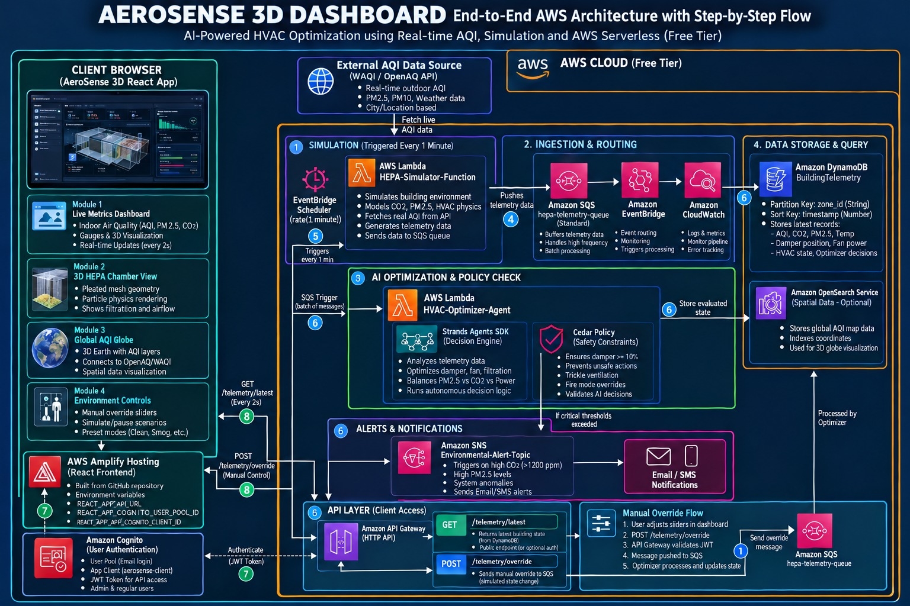

# AeroSense 3D

**AI-assisted HVAC optimisation on AWS serverless, with a 3D digital twin and a live global AQI map.**

AeroSense ingests building telemetry every minute, runs it through an optimiser that recommends damper
positions and raises air-quality alerts, and presents the result in a React dashboard behind Amazon Cognito
authentication.

🔗 **Live:** https://main.d2a5305jofq8oe.amplifyapp.com
📍 **Region:** `ap-south-1` · **Stack:** React 18 + Vite · Three.js · Lambda · API Gateway (HTTP API) · DynamoDB · SQS · SNS · Cognito · Amplify

> **AeroSense is advisory.** It computes and displays recommendations. It is not connected to any physical
> HVAC equipment and never actuates hardware. Telemetry is produced by a simulator Lambda; the AWS pipeline
> that carries, evaluates, stores and serves it is real.

---

## Architecture



### As deployed

The diagram above is the design overview. The table below records where the running stack differs from it, so
the two can be read together.

| In the diagram | Actually deployed |
|---|---|
| EventBridge between SQS and the optimiser | **EventBridge Scheduler** (`minute-trigger`, `rate(1 minutes)`) invokes the simulator. SQS reaches the optimiser through a Lambda **event source mapping**. |
| `REACT_APP_*` environment variables | **`VITE_*`** — this is a Vite build, not Create React App. |
| `POST /telemetry/override` and the manual-override flow | **Not deployed.** No override route exists on the API. |
| `GET /telemetry/latest` public / optional auth | **JWT-protected.** Every telemetry route returns `401` without a valid bearer token. |
| Dashboard polls every 2 s | **12 s** poll interval. |
| Strands Agents SDK + Cedar policy engine | **Not used.** The optimiser is deterministic Python (`boto3`, stdlib). The "damper ≥ 10 %" safety rule is a clamp inside the handler. |
| Amazon OpenSearch Service | **Not provisioned** (`list-domain-names` returns empty). Marked optional in the diagram. |
| DynamoDB sort key `timestamp (Number)` | **String** (`S`) holding epoch seconds, e.g. `"1791665633"`. |
| — | A **Cognito auth Lambda** (`aerosense-auth-service`) sits in front of Cognito. It is not in the diagram but is required; see [Authentication](#authentication). |

---

## How it works

```
EventBridge Scheduler  ──(every 1 min)──▶  HEPA-Simulator-Function
                                                   │ telemetry JSON
                                                   ▼
                                          SQS hepa-telemetry-queue ──▶ DLQ (after 3 receives)
                                                   │ event source mapping
                                                   ▼
                                          HVAC-Optimizer-Agent
                                             ├─ recommends damper %
                                             ├─ raises alert strings
                                             ├─ writes DynamoDB BuildingTelemetry
                                             └─ publishes SNS when alerts exist
                                                   │
   React (Amplify) ──bearer JWT──▶ API Gateway ──▶ AeroSense-API-Function ──▶ DynamoDB
```

**The optimiser** reads each telemetry message and applies threshold rules to CO₂, indoor PM2.5 and outdoor
AQI, producing `recommended_damper_pct` alongside the current `damper_pct`, plus an `optimizer_reason`
string. The recommendation is clamped to 10–100 % so ventilation is never fully closed. It emits
`optimizer_status: "recommendation_only"` — the system advises, it does not actuate. Alerts are plain strings
such as `"High indoor CO2: 1555 ppm"`, stored on the record and published to SNS.

**CloudWatch alarms** `AeroSense-Optimizer-Errors` and `AeroSense-SQS-Backlog` notify the same SNS topic.

---

## API reference

Base URL: `https://w13tvv9i82.execute-api.ap-south-1.amazonaws.com`

### Telemetry — JWT protected

Send `Authorization: Bearer <Cognito access or ID token>`. The HTTP API JWT authorizer validates the issuer
and matches the audience against the app client, so **both** token kinds are accepted.

| Route | Returns |
|---|---|
| `GET /health` | **Public.** `{"status":"ok","service":"AeroSense API"}` |
| `GET /zones` | `{"count":1,"zones":["zone-01"]}` — an array of **id strings**, no display names |
| `GET /telemetry/latest?zone_id=zone-01` | `{"item":{…}}`, or `404` when the zone has no records |
| `GET /telemetry/history?zone_id=zone-01&limit=20` | `{"zone_id":"…","items":[…]}`, **newest first**, `limit` 1–100 |
| `GET /alerts?zone_id=zone-01&limit=20` | `{"count":N,"items":[…]}` — whole telemetry records whose `alerts` array is non-empty |

### Authentication — public, `POST`

`/auth/signin` · `/auth/signup` · `/auth/confirm-signup` · `/auth/resend-confirmation` ·
`/auth/refresh` · `/auth/signout` · `/auth/forgot-password` · `/auth/confirm-forgot-password` ·
`/auth/respond-challenge`

Responses are `{ok: true, …}` or `{ok: false, code, message}`. Credential failures collapse to
`INVALID_CREDENTIALS` so the API cannot be used to enumerate accounts.

---

## Data model

`BuildingTelemetry` — partition key `zone_id` (S), sort key `timestamp` (S, epoch seconds).

```jsonc
{
  "zone_id": "zone-01",
  "timestamp": "1791665633",          // epoch SECONDS, as a string
  "outdoor_aqi": 122,
  "outdoor_pm25": 192.43,
  "indoor_pm25": 47.2,
  "temperature": 26.3,                // °C
  "humidity": 32.35,                  // % RH
  "co2": 1298,                         // ppm
  "occupancy": 58,
  "damper_pct": 12.77,                // current position
  "recommended_damper_pct": 35,       // optimiser recommendation — kept distinct
  "fan_power_kw": 2.34,
  "current_fan_power_kw": 2.34,
  "alerts": ["High indoor CO2: 1298 ppm"],
  "optimizer_status": "recommendation_only",
  "optimizer_reason": "Elevated CO2: improve ventilation",
  "source": "simulator"
}
```

### Fields the API does not publish

Fan speed %, filter health %, filter pressure drop, cumulative energy and cumulative cost are **not in any
record**. The dashboard renders them as `N/A` and names them in a dismissible notice. They are never
estimated, defaulted or carried over from a previous reading — a card showing a number means AWS sent that
number.

---

## Authentication

The Cognito app client is **confidential** (it has a client secret), so Cognito rejects `InitiateAuth` unless
the caller supplies

```
SECRET_HASH = Base64( HMAC-SHA256( key = clientSecret, msg = username + clientId ) )
```

A browser cannot compute that without shipping the secret in the bundle. `backend/auth-service/` is a Lambda
that reads the secret from **Secrets Manager**, computes `SECRET_HASH` server-side, and returns only the
resulting tokens. Its execution role carries exactly one permission beyond logging:
`secretsmanager:GetSecretValue` on that one secret.

**Token handling.** Access and ID tokens live in memory only. The refresh token is kept in `sessionStorage`,
which lets a page reload restore the session while a closed tab ends it. Exchanging it requires the Lambda.

**Alias pool caveat.** The pool uses `UsernameAttributes: [email]`, so the internal username is a UUID while
people sign in with an email. `REFRESH_TOKEN_AUTH` computes `SECRET_HASH` over the *internal* username, so
the Lambda returns that for refresh and a separate `displayName` for the UI.

**The dashboard is never rendered unauthenticated.** A route guard keeps the tree unmounted until Cognito
issues a session, and the "Authenticated Session Active" indicator requires that API Gateway's authorizer
actually accepted a token on a real request — not a local boolean.

> **Known limitation.** Logging out revokes the refresh token and globally signs out, but a *previously
> issued* access token stays valid until it expires, because JWT authorizers verify signature and `exp`
> locally and never call Cognito. The browser clears its copy, so the window is the token lifetime
> (currently 60 minutes). Reducing `AccessTokenValidity` shrinks it.

---

## Frontend

| Module | What it does |
|---|---|
| **Live metrics** | AQI, PM2.5, CO₂, temperature, humidity, damper vs recommendation, with sparklines from `/telemetry/history` |
| **3D HEPA chamber** | Three.js digital twin — procedural geometry, airflow and particles, three camera presets |
| **Global AQI map** | Leaflet + Open-Meteo. **Outdoor ambient** readings for a map location, labelled distinctly from indoor zone telemetry |
| **Simulation mode** | Locally generated values, unmistakably labelled, isolated from AWS Live |

**AWS Live integrity.** A failed API call never falls back to simulated values: the last good reading is kept
and flagged `STALE`, or an explicit empty/error state is shown. Each poll carries a sequence stamp and is
aborted on zone change, so a slow response cannot overwrite newer data or another zone's data.

**HEPA figures** (99.97 % at 0.3 µm MPPS, 32 pleats) are **illustrative H13 reference model parameters** that
describe the visualisation. They are not measurements of installed equipment, and bypass leakage is not
modelled.

---

## Running locally

```bash
npm install
cp .env.example .env     # fill in the values below
npm run dev              # http://localhost:3000
```

`http://localhost:3000` is already an allowed CORS origin on the API.

### Environment variables

All are **public build-time config**. No secret belongs here — the Cognito client secret lives only in
Secrets Manager.

| Variable | Purpose |
|---|---|
| `VITE_AEROSENSE_API_URL` | API Gateway base URL, absolute, no trailing slash |
| `VITE_AWS_REGION` | `ap-south-1` |
| `VITE_COGNITO_USER_POOL_ID` | Cognito user pool id |
| `VITE_COGNITO_CLIENT_ID` | App client id |
| `VITE_COGNITO_TOKEN_TYPE` | `access` (default) or `id` — a hint; a mismatch costs one retry |
| `VITE_ALLOW_SELF_SIGNUP` | `true` shows the create-account form. Mirror `ALLOW_SELF_SIGNUP` on the Lambda |

A missing `VITE_AEROSENSE_API_URL` is a hard configuration error — the app will not silently fall back to
relative paths.

---

## Testing

```bash
npm test          # vitest, single run
npm run test:watch
npm run build     # production build
```

**134 tests** cover the route guard and session handling, token validation and refresh, API error
classification (401 / 403 / 404 / network / CORS / timeout / parse), the real response schemas, signup and
confirmation, the alert hierarchy, safe number formatting, and zone-switch race protection.

Two behaviours are pinned by mutation tests — reverting the fix makes them fail with the original production
error:

- `fanSpeedPct.toFixed(1)` on a null metric, which blanked the dashboard
- a stale zone response overwriting the newly selected zone

---

## Deploying

### Auth service

```bash
cd backend/auth-service
aws cognito-idp describe-user-pool-client \
  --user-pool-id <POOL_ID> --client-id <CLIENT_ID> --region ap-south-1 \
  --query 'UserPoolClient.ClientSecret' --output text      # do not commit or echo this

COGNITO_CLIENT_SECRET='<value>' ./deploy.sh
```

`deploy.sh` is idempotent: it creates the secret, execution role, function, integration, the nine `/auth/*`
routes and the invoke permission, then smoke-tests `/auth/signin`. Re-running updates code and configuration
and leaves the stored secret untouched. It creates **no** new Cognito resources.

### Frontend

Amplify builds `main` automatically on push (`npm ci` → `npm run build` → `dist`), with an SPA rewrite of
`/<*>` → `/index.html`.

---

## Repository layout

```
src/
  components/
    Auth/            LoginScreen, ProtectedRoute, BootSplash, shared form primitives
    AeroDashboard/   metric cards, telemetry audit, 3D twin, alert strip
    GlobalMap/       Leaflet AQI map
    HepaChamber/     3D HEPA visualisation
    ErrorBoundary.jsx
  context/AuthProvider.jsx    single authoritative auth state machine
  services/
    auth.js          Cognito via the auth Lambda; token lifecycle
    aeroSenseApi.js  centralised API client
  utils/
    telemetryMapper.js  maps the real API schema; null for unpublished fields
    formatNumber.js     safe formatting — "N/A", never a fabricated 0
backend/auth-service/  SECRET_HASH broker Lambda + idempotent deploy script
docs/architecture.jpg
```

---

## Design principles

1. **Never fabricate a reading.** A missing field is `N/A`, not a default that looks plausible.
2. **Never fake authentication.** The session indicator reflects a token the API authorizer accepted.
3. **Never silently degrade.** A failed AWS call shows a stale or error state; it does not become simulation.
4. **Never claim actuation.** The UI says "view", "recommend" and "mute alarm", never "engage".
5. **The client secret never reaches the browser.**

---

## Licence

Built for a hackathon submission. © 2026 — see repository owner.
